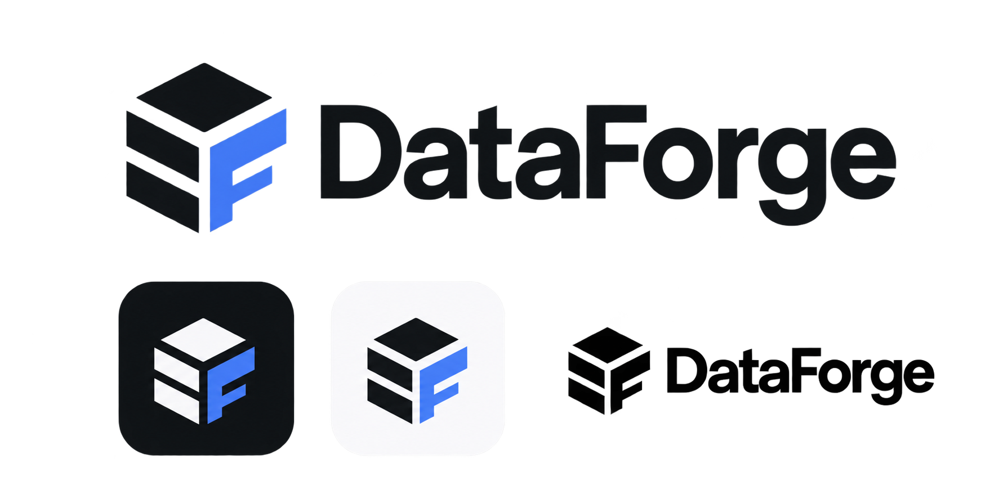

<div align="center">
  
</div>

# DataForge

A modern, free, **AI-native database client** — a lightweight alternative to Navicat.
Built with Tauri (Rust) + React. Connect to your databases, write SQL, browse and
copy data, and generate SQL from plain language with the AI provider of your choice.

> ⚡ ~6 MB installer · native desktop app · dark & light themes · Windows / macOS / Linux

## Features

- **Multi-database:** MySQL, PostgreSQL, SQLite (SQL Server & MongoDB planned)
- **SQL editor** (Monaco) with run (Ctrl+Enter), multi-tab, and formatting
- **Data grid:** fast virtualized results, table data view, cell/range select &
  copy (TSV / CSV / JSON / INSERT), column resize & reorder, value viewer
- **AI → SQL:** describe a query in plain language (incl. Azerbaijani) and get SQL.
  Bring your own provider — **OpenAI, OpenRouter, Google Gemini, Groq, or a local
  model (Ollama / LM Studio)**. API keys are stored in the OS keychain, never in the app.
- **Connection management:** connect / disconnect / edit / delete, SSH & SSL tabs (planned)
- **Native feel:** menu bar, system tray, notifications, no browser chrome

## Install (users)

Download the installer for your OS from the [**Releases**](../../releases) page:

- **Windows:** `DataForge_x.y.z_x64-setup.exe` (or `.msi`) → double-click → install.
  (Unsigned build → Windows SmartScreen may show "More info → Run anyway".)
- **macOS:** `.dmg` → drag to Applications.
- **Linux:** `.AppImage` (make it executable) or `.deb`.

No Node or Rust needed — the installer bundles everything.

## Build from source (developers)

Requirements: **Node 18+**, **Rust 1.77+**, and (Windows) the MSVC Build Tools.

```bash
git clone https://github.com/ismayilisayev/deltaforge.git
cd deltaforge
npm install
npm run tauri dev      # run in development
npm run tauri build    # produce installers in src-tauri/target/release/bundle/
```

## Tech stack

- **Backend:** Rust, Tauri 2, sqlx, reqwest, keyring
- **Frontend:** React 18, TypeScript, Vite, Monaco, Lucide icons
- See [`docs/`](docs/) for the architecture, IPC contract, and AI integration.

## License

[MIT](LICENSE) — free to use, modify, and distribute.
